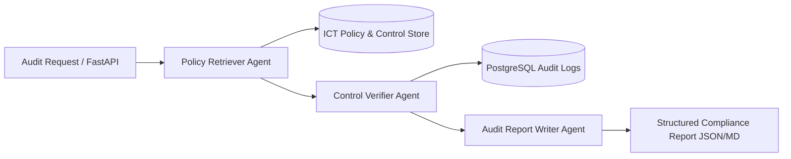

# Agentic RAG Compliance & IT Audit Assistant

[](https://www.python.org/)
[](https://www.crewai.com/)
[](https://fastapi.tiangolo.com/)
[](https://www.postgresql.org/)
[](LICENSE)

A multi-agent **Agentic RAG Compliance & IT Audit Assistant** built with **CrewAI**, **Gemini / OpenAI**, **FastAPI**, and **PostgreSQL**. It ingests ICT security policies, cross-checks IAM access controls, backup/recovery logs, and network configurations, and generates structured compliance audit reports with risk ratings and remediation steps.

---

## Architecture



## Key Features

- **Role-Based Multi-Agent Crew (`CrewAI`):** Separates policy retrieval, technical control verification, and executive audit report synthesis.
- **IAM & Backup Control Checks:** Detects overly permissive roles, missing MFA, and unverified backup/recovery schedules.
- **Risk-Scored Findings:** Classifies control gaps as `High`, `Medium`, or `Low` with concrete technical remediation.
- **Containerized & CI-Ready:** Includes PostgreSQL Docker Compose stack, FastAPI `/docs`, and GitHub Actions CI.

## Project Structure

```text
agentic-rag-compliance-auditor/
├── .github/workflows/ci.yml   # Automated test CI
├── src/
│   ├── __init__.py
│   ├── config.py              # App & database settings
│   ├── models.py              # Pydantic audit schemas
│   ├── agents.py              # Multi-agent RAG & verification pipeline
│   └── main.py                # FastAPI entrypoint
├── tests/
│   └── test_audit.py          # Unit tests for control checks
├── .env.example
├── .gitignore
├── Dockerfile
├── docker-compose.yml
├── LICENSE
└── requirements.txt
```

## Quickstart

### 1. Local Setup
```bash
git clone https://github.com/nazmulahmedsolaiman/agentic-rag-compliance-auditor.git
cd agentic-rag-compliance-auditor
python -m venv .venv
source .venv/bin/activate  # On Windows: .venv\Scripts\activate
pip install -r requirements.txt
cp .env.example .env
uvicorn src.main:app --reload
```

### 2. Docker Compose (API + PostgreSQL)
```bash
docker compose up --build
```
Open Swagger UI at `http://localhost:8000/docs`.

## Running Tests
```bash
pytest -v
```
